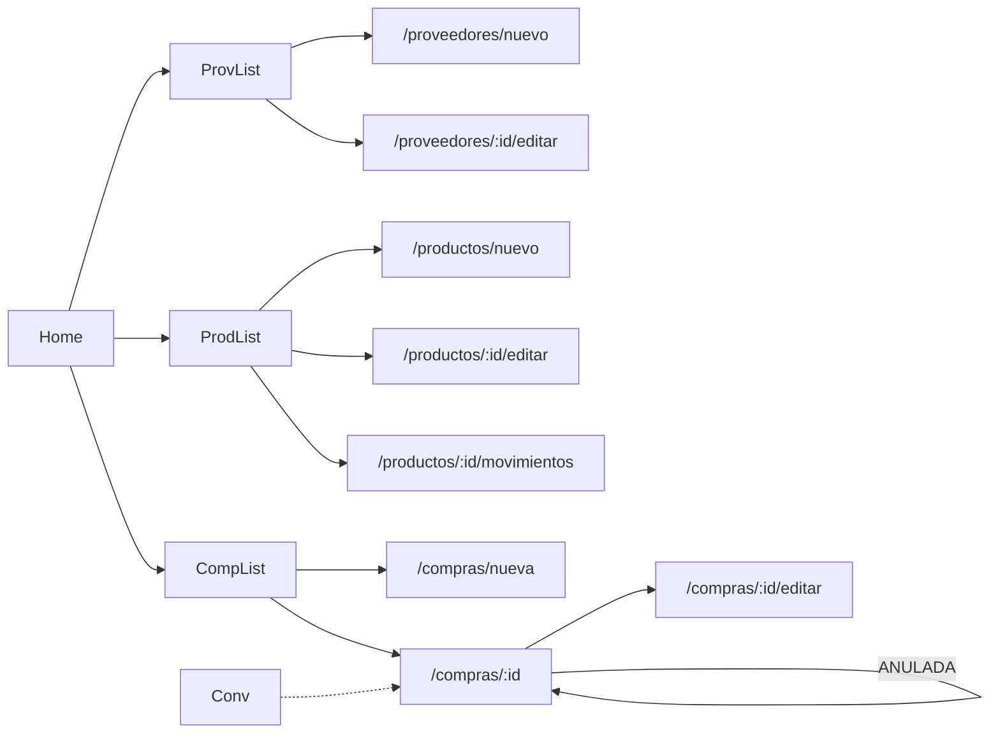

# F-1 · Visión del Frontend — Proveedores y Compras

**Autor:** Orellana Rodriguez Jose Miguel · Arquitectura de Microservicios
**Stack fijo:** Vue 3 (`<script setup>`, Composition API) · Vite · JavaScript · Vue Router · Pinia · Vitest + @vue/test-utils · ESLint + Prettier · CSS propio · fetch nativo (sin librerías de UI ni de HTTP).

> Nota de contrato (importante para la sustentación): la guía N.° 03 exige que
> cada detalle de compra envíe `precioUnitario` (el cliente puede tener precios
> distintos al catálogo; `Producto.precio` queda como referencia). El frontend
> envía **solo** `{ proveedorId, observaciones, detalles:[{productoId, cantidad, precioUnitario}] }`:
> nunca envía `total`, `estado` ni `creadoPor`. El backend es autoridad; la UI es espejo.

## Mapa de pantallas (13 rutas)

```text
/                       Home (resumen)
/proveedores            Listado (búsqueda por texto + filtro ACTIVO/INACTIVO)
/proveedores/nuevo      Formulario crear proveedor
/proveedores/:id/editar Editar proveedor
/productos              Listado (filtro por proveedor, badge bajoStockMinimo)
/productos/nuevo        Crear producto
/productos/:id/editar   Editar producto
/productos/:id/movimientos  Historial de stock (kardex)
/compras                Listado (filtro por proveedor y por estado)
/compras/nueva          Nueva compra (arma líneas; total ESTIMADO)
/compras/:id            Detalle (acciones según estado + auditoría)
/compras/:id/editar     Editar (solo REGISTRADA)
*                       404 (comodín)
```

## Diagrama de navegación (Mermaid)



## Diagrama de flujo de datos

```mermaid
flowchart LR
    B[Navegador] -->|fetch (10s) HTTP/JSON| G[API Gateway :8080]
    G --> P[ms-proveedor :8081]
    G --> R[ms-producto :8082]
    G --> K[ms-compra :8083]
    P --> D1[(bd_proveedor)]
    R --> D2[(bd_producto)]
    K --> D3[(bd_compra)]
    subgraph Infra
        E[Eureka :8761]
    end
    G -.-> E
```

Reglas: el frontend habla **SOLO** con el Gateway (dev vía proxy `/api → http://localhost:8080`; prod vía nginx proxy inverso mismo origen). Jamás se llama a 8081/8082/8083.

## Árbol de carpetas final

```text
frontend/
├─ index.html
├─ package.json
├─ vite.config.js         # alias @, proxy /api → :8080 (dev), sourcemap=false
├─ vitest.config.js
├─ eslint.config.js       # vue/no-v-html como ERROR
├─ .env.example           # VITE_API_BASE_URL / VITE_API_PROXY_TARGET
├─ .gitignore             # .env* ignorado (excepto .env.example)
├─ public/favicon.ico
└─ src/
    ├─ api/               # apiClient + proveedorApi + productoApi + compraApi
    ├─ assets/main.css    # CSS propio (sin frameworks)
    ├─ components/        # TablaDatos, BotonAccion, ConfirmDialog,
    │                      CampoFormulario, AlertaError, EstadoBadge, FormErroresServidor
    │                      + __tests__/
    ├─ composables/       # useAccionUnica (guardián de doble envío)
    ├─ router/index.js    # rutas + guard de :id entero positivo
    ├─ stores/            # usuarioStore (memoria + sessionStorage), notificacionesStore
    ├─ utils/             # money.js (centavos), validators.js, formatters.js + __tests__/
    └─ views/             # proveedores/, productos/, compras/, 404
```

## Requisitos de seguridad → dónde se implementa (C1–C13)

| Req | Dónde |
|---|---|
| C1 Render seguro (prohibido `v-html`/`innerHTML`/`eval`) | ESLint `vue/no-v-html: error`; interpolación `{{ }}` en todos los componentes; prueba anti-XSS (F-12) |
| C2 Almacenamiento (sin tokens en storage) | `usuarioStore.js` → memoria (Pinia) + respaldo `sessionStorage`; nunca `localStorage`; sin autenticación real (documentado) |
| C3 Identidad (`X-Usuario` simulado) | `apiClient.js` → cabecera desde el store; siempre visible en UI ("Usuario (simulado)"); el backend decide |
| C4 No confiar en el cliente (total estimado) | `CompraNuevaView` → etiqueta "total estimado"; nunca se envía `total`/`estado`/`creadoPor`; el backend responde el real |
| C5 Dinero (centavos enteros) | `utils/money.js` → parsear/sumar/formatear en enteros; rej. `Number.isSafeInteger` |
| C6 Doble envío (botón deshabilitado NO basta) | `composables/useAccionUnica.js` (guardián) + `BotonAccion.vue` (`loading`) |
| C7 Errores normalizados a texto; 503 genérico | `apiClient.js` → `ErrorApi`; `AlertaError.vue`/`FormErroresServidor.vue` renderizan `message`/`details` como texto |
| C8 Secretos (env sólo `.env.example`; sourcemaps off) | `.env.example`, `.gitignore`, `vite.config.js` (`sourcemap: false`) |
| C9 Cabeceras y despliegue (nginx) | `nginx.conf` (F-13): CSP estricta, nosniff, HSTS condicional, X-Frame-Options… |
| C10 Enlaces y rutas (:id enteros positivos) | `router/index.js` (guard valida `/^\d+$/` y > 0); `rel="noopener noreferrer"`; comodín 404 |
| C11 Dependencias (audit + lockversioned) | `package-lock.json` versionado; `npm audit --omit=dev` = 0 en prod; 11 moderadas en dev (documentado) |
| C12 Red (timeout 10 s; sólo mismo origen; JSON) | `apiClient.js` (`AbortController`, `credentials: 'same-origin'`) |
| C13 Validación cliente (espejo del backend) | `utils/validators.js` + errores 400 del backend visibles en formularios |
